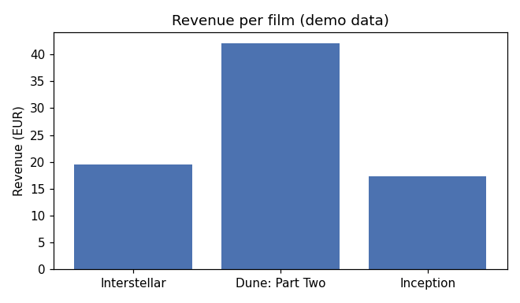

# Cinema Box Office (Python CLI)

A role-based command-line app for a small cinema. It manages films and screenings, sells and refunds tickets, and produces revenue and occupancy reports with matplotlib charts. Data is stored in plain `;`-separated text files, with no database. It was built as the semester project for **Scripting Languages** (*Skript jezici*), Faculty of Sciences (PMF), University of Novi Sad, 2nd year, academic year 2024/25.



## Features

- **Login with three roles.** Passwords are stored as SHA-256 hashes.
  - **administrator**: CRUD for films and screenings, reports, charts.
  - **cashier** (*blagajnik*): list screenings, sell tickets, refund (cancel) a sale, charts.
  - **customer** (*kupac*): browse films and screenings, buy tickets, see own purchases.
- **Validation**:
  - no duplicate IDs;
  - a screening must reference an existing film;
  - dates and times must parse (`YYYY-MM-DD`, `HH:MM`);
  - quantity must be > 0;
  - sales cannot exceed the remaining seat capacity.
- **Cascading deletes**: deleting a film removes its screenings and their sales.
- **Reports**: revenue per film, average occupancy per film (%), tickets sold per day.
- **Charts**: matplotlib bar charts for tickets per day and revenue per film. The app still runs without matplotlib and prints a warning instead.
- **Persistence**: everything is loaded at startup and saved on exit. On first run, sample data is seeded automatically.

## Example session

```text
=== Prijava ===
Ulogovani ste kao admin [administrator]

[ADMIN] 1) filmovi  2) projekcije  3) izveštaji  4) grafici  0) sačuvaj i izlaz
> 3
Prihod po filmu:
- Dune: Part Two: 42.00
- Interstellar: 19.50
- Inception: 17.40

Prosečna popunjenost po filmu (%):
- Dune: Part Two: 5.00%
- Inception: 3.33%
- Interstellar: 2.50%
```
(The UI is in Serbian, the course language: *filmovi* = films, *projekcije* = screenings, *izveštaji* = reports, *grafici* = charts.)

## Structure

The app is organised in layers:

| Module | Responsibility |
|---|---|
| `app.py` | entry point: seed, load, login, role menu, save on exit |
| `models.py` | `@dataclass` models: `User`, `Film`, `Projection`, `Sale` |
| `storage.py` | generic read/write of `;`-separated files |
| `repo.py` | in-memory repository: load/save all entities |
| `auth.py` | password hashing and authentication |
| `services.py` | business logic: CRUD, ticket sales, reports |
| `plots.py` | matplotlib charts |
| `ui.py` | text menus per role |
| `seed.py` | creates `data/` with sample data on first run |

## Running it

```bash
python -m pip install -r requirements.txt   # optional, only needed for charts
python app.py
```

Demo accounts (created by `seed.py`):

| user | password | role |
|---|---|---|
| `admin` | `admin` | administrator |
| `pera` | `pera123` | cashier |
| `mika` | `mika123` | customer |

## What I learned

- Structuring a Python program into modules with clear responsibilities instead of one large script. An earlier version was a single ~600-line file.
- Using `dataclasses`, type hints and small pure functions for business rules.
- Doing file-based persistence and validation by hand, and seeing why databases exist.
- Basic data visualisation with matplotlib.

## Possible improvements

- Catch `ValueError`s in the menu loop so that a typo prints an error instead of ending the session.
- Replace the text files with SQLite, and add unit tests for `services.py`.
- Generate sale IDs from the maximum existing ID rather than the list length, so IDs are not reused after a refund.

---
Author: Sergej Stojanović, Information Technologies student at PMF Novi Sad.
